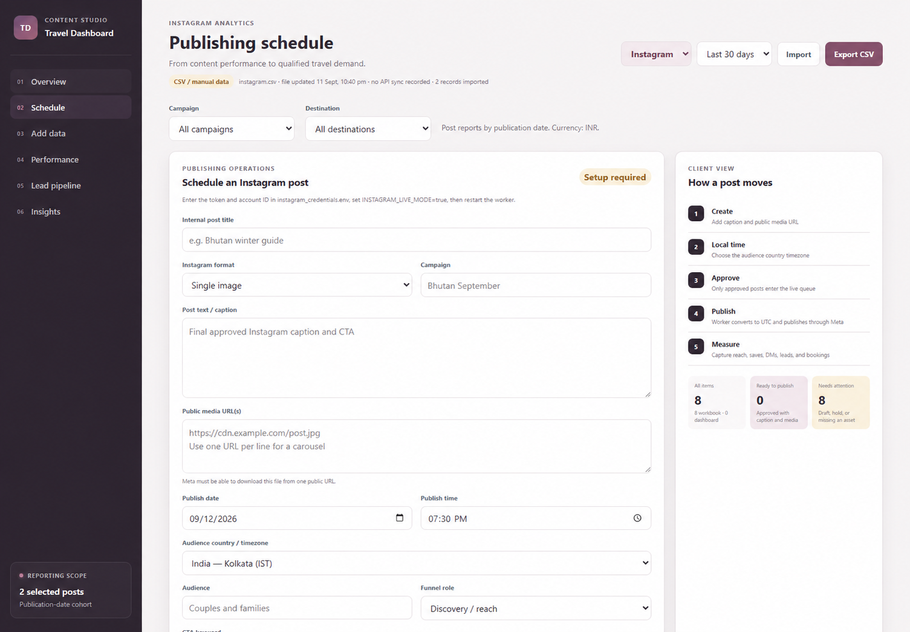
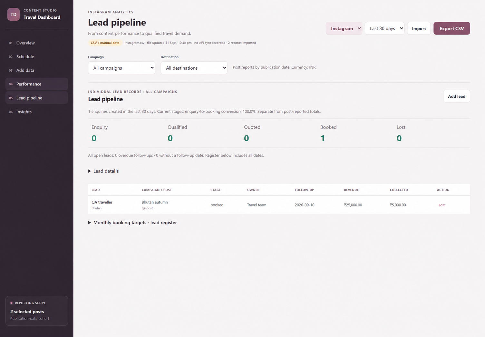

## The business need

A travel-sector business needed structured processes for identifying potential partners, preparing outreach and maintaining social content. The work combined research procedures, reusable content materials and a separate dashboard workstream for reporting and enquiry management.

## My contribution

I developed lead-generation and outreach procedures and reusable templates for the client. I also created finished social posts, carousels and captions. I used AI assistance during development and content work, while designing the business logic and reviewing the work.

The accompanying content dashboard brings performance records, scheduling and lead tracking into one interface. It uses a Python backend with JSON APIs and an HTML, CSS and JavaScript frontend.

## Research workflow

The project included a staged Python research pipeline for collecting listings, enriching records, grouping them by organizer identity and applying configurable qualification rules. Browser-based extraction used Playwright, with CSV and JSON outputs for review.

Qualification kept yes, no and unknown signals separate. Records with missing evidence could be routed to human review, with supporting evidence, review reasons and manual corrections retained in an audit.

## Content and business dashboard

The dashboard provides six views: Overview, Schedule, Add Data, Performance, Lead Pipeline and Insights. Instagram and LinkedIn reporting share platform, period, campaign and destination filters.

- Overview presents recorded content and commercial metrics with coverage indicators.
- Schedule prepares captions, media references, publishing dates, audience timezones and approval status. Publishing workers are configured separately from the interface.
- Add Data supports manual records and validated CSV import, with structured export for further review.
- Performance organizes post and campaign results for comparison.
- Lead Pipeline tracks enquiry stages, owners, next follow-up dates, attribution and booking information.
- Insights surfaces recommendations from the available reporting data.

Instagram reporting uses CSV or manually entered metrics. The code also includes a separately configured LinkedIn statistics-sync integration.

## Dashboard screenshots

The dashboard images are digitally anonymised for confidentiality and use demonstration data from the supplied verification files. The displayed brand is a neutral portfolio label. Lead counts, bookings, revenue and other figures illustrate the interface; they are not client performance results.

<figure class="case-visual">
  
  <figcaption>Schedule view: content preparation and publishing controls, shown with demonstration data.</figcaption>
</figure>

<figure class="case-visual">
  
  <figcaption>Lead Pipeline view: stages, follow-up tracking and booking fields, shown with a fictional test record.</figcaption>
</figure>

## Data quality and workflow design

The reporting workflow treats blank numeric fields as unknown and displays metric coverage. Undated records remain available in All records but are excluded from date-filtered reports. Duplicate post IDs and invalid import rows are checked before records are saved.

Post-reported totals and individual lead records remain separate reporting sources. Attribution fields are entered manually, keeping recorded business information distinct from platform statistics.

## Outreach and content

I prepared procedures and templates the client could use after research and qualification. The content work included research, campaign structure, captions, visual briefs, and finished posts and carousels.

## What I delivered

- B2B lead-generation and outreach procedures.
- Reusable outreach templates and operating documentation.
- Research and qualification workflows with review outputs.
- Finished social posts, carousels and captions.
- A dashboard prototype covering content reporting, schedule preparation, data import and a lead register.

## Client use

The client used the outreach procedures and content materials. The finished social content was published on social media.
